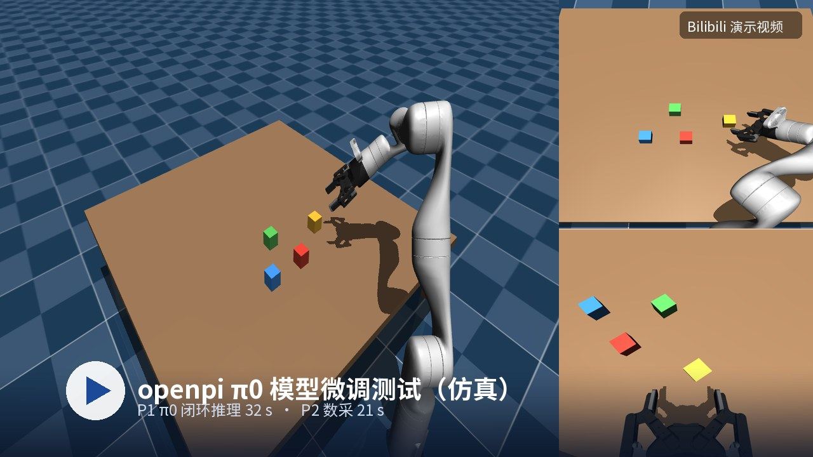

# VR Teleop · Meta Quest + MuJoCo

用 **Meta Quest 手柄**遥操作 MuJoCo 里的机械臂，并把操作过程录成
**LeRobot v2.1** 数据集（可直接喂 π0 / OpenPI 做 VLA 微调）。
全部在仿真里跑，不碰真机，不需要 ROS、不需要装 App 或 SteamVR。

内置 **Kinova Gen3 + Robotiq 2F-85** 参考场景；换自己的臂只改一个
`robot_profile.py`，核心代码不动。

---

## 快速开始

```bash
git clone <this-repo> vr-teleop-sim && cd vr-teleop-sim

python3 -m venv .venv
.venv/bin/pip install -r requirements.txt

.venv/bin/python tools/check_profile.py   # 模型/关节/夹爪刻度/相机 自检
./run.sh                                  # 第一次会自动生成自签 HTTPS 证书
```

终端会问要不要采集、要的话填任务描述。然后**在 Quest 浏览器里**打开：

```
https://<电脑的局域网 IP>:8444
```

> 提示"连接不是私密连接" → 高级 → 继续前往。IP 变了重跑 `./scripts/make_cert.sh`。

戴头显，**按住手柄侧键**开始跟随。

---

## 手柄操作

### 单臂（默认）

| 输入 | 作用 |
|---|---|
| **右手柄 侧键按住** | 锁定跟随：以按下瞬间的头显朝向为参考系，手到哪末端到哪 |
| 松开 | 冻结末端 |
| **右手柄 扳机** | 夹爪：松开=全开，扣到底=闭合 |
| **右手柄 A / B** | 回初始位 + 夹爪张开 + 物块归位 |
| **左手柄 扳机** | （采集）切片，结束本段 |
| **左手柄 X / Y** | （采集）X=成功保存 / Y=失败整段丢弃 |

按住侧键而不是一直跟随：松手可以休息、机械臂不动；再按住会以当前头显朝向
重新校准，长时间操作不累积漂移。

### 双臂

两条臂各绑一只手，各自独立（左手侧键控左臂、左扳机控左夹爪，右手同理）。

仓库**不自带双臂模型**，用你自己的 MJCF：

```bash
cp robot_profile_example.py robot_profile_mydual.py    # 填 arms=[...]
VR_TELEOP_PROFILE=robot_profile_mydual ./run.sh
```

步骤、MJCF 骨架、验证方法见 **[docs/08_DUAL_ARM.md](docs/08_DUAL_ARM.md)**。
双臂暂不支持数据采集。

---

## 换成你自己的机械臂

```bash
cp robot_profile_example.py robot_profile_myarm.py    # 改字段
.venv/bin/python tools/list_model.py your.xml         # 打印索引表，填 offset 用
VR_TELEOP_PROFILE=robot_profile_myarm .venv/bin/python tools/check_profile.py
VR_TELEOP_PROFILE=robot_profile_myarm ./run.sh
```

`check_profile.py` 会指出哪一项对不上（site 名、执行器顺序、夹爪行程、home 越限…），
并且真的驱动一次夹爪验证开合方向。

支持任意关节数（5 / 6 / 7 轴）。**换轴数会改变数据集维度**（`n_arm_qpos + 1`），
不同机器人的数据不能混训 —— 见 [docs/03](docs/03_PORT_YOUR_ROBOT.md) §4。

手柄映射（用哪只手、轴方向、灵敏度、是否跟姿态）也能改：

```python
teleop=TeleopSpec(drive_hand="right", follow_orientation=True, scale=1.0,
                  axis_signs=(-1, -1, 1))
```

---

## 演示视频

[](https://www.bilibili.com/video/BV1AEnw6hEEC)

点封面跳转 B 站：P1 π0 闭环推理（32 s）· P2 数采（21 s）。

> GitHub 的 README 不支持内嵌播放器（`<iframe>` 会被过滤掉），所以用
> "封面图 + 跳转"的方式。

---

## 数据集

```
data/lerobot/meta/info.json          特征定义
data/lerobot/data/chunk-000/*.parquet
data/lerobot/videos/chunk-000/observation.images.*/*.mp4
```

* **LeRobot v2.1**，50 Hz，`lerobot` 库可直接 `LeRobotDataset` 加载
* `state` / `action` = `[joint_1..joint_N, gripper]`，夹爪归一化到 `[0,1]`
* 相机默认 3 路（侧面全局 / 腕部 / 俯视全局），640×480，H.264
* **每路可单独开关**（`preview` 看画面 / `record` 写数据集）。
  通常只录两路：腕部 + 侧面全局或俯视全局二选一，见 [docs/04 §3](docs/04_CAMERAS.md)
* 失败集按 Y **整段丢弃**，不占 episode 编号

详见 [docs/05](docs/05_DATA_COLLECTION.md)。

---

## 目录结构

```
run.sh                  启动入口（找解释器 + 依赖自检）
server.py               HTTP/WS 服务 + 500Hz 控制循环 + IK
robot_profile.py        ★ 换机器人只改这个文件
index.html              Quest 端 WebXR 页面
camview.py              相机预览窗口（独立线程 / 独立 GL 上下文）
dataset_recorder.py     LeRobot v2.1 写入器
runlog.py / glutil.py   运行日志 / GL 上下文串行化
assets/                 参考场景 + Kinova Gen3 模型
video/                  演示视频（H.264）+ B 站封面
tools/                  check_profile / list_model / validate_e2e / validate_dual
docs/                   01 上手 · 02 架构 · 03 接入自己的臂 · 04 相机
                        05 数采 · 06 排障 · 07 AI agent 交接 · 08 双臂
```

> **AI agent** 请从 [docs/07_AGENT_HANDOFF.md](docs/07_AGENT_HANDOFF.md) 开始读：
> 仓库地图、不变量、调试顺序、交付前的验证门。

---

## 已验证环境

```
Ubuntu 20.04 / 22.04 (X11)
Python 3.11, MuJoCo 3.14, numpy 2.x, aiohttp 3.x
GPU: 任意支持 OpenGL 3.3 的显卡（实测 AMD RX 5500 XT）
头显: Meta Quest 1（Quest 2/3 应同样可用）

3 路 640×480 + 3 个预览窗口：
  不裁渲染通道          37 Hz  ← 不够 50Hz
  关 shadow+reflection  50 Hz  ← 默认
```

---

## 已知限制

* **只做仿真**。没有真机驱动；真机要自己接 Kortex / ROS / 自家 SDK，
  但 profile 抽象和"位置指令 + 50Hz"的约定可以直接用。
* 参考实现的**桌面与方块写在 `assets/scene_grasp.xml` 里**，换机器人基本要重做场景。
* 坐标映射默认值按 Quest 手柄调好，换头显/手柄要重标（[docs/03 §9](docs/03_PORT_YOUR_ROBOT.md)）。
* 竖直朝下抓取在参考模型上有"夹得住抬不起"现象（根因未钉死，见 [docs/06](docs/06_TROUBLESHOOTING.md)）。

---

## 协议

代码 **MIT**。参考模型（Kinova Gen3 / Robotiq 2F-85）来自 MuJoCo Menagerie 与厂商
公开描述文件，遵循其原始许可，见 [THIRD_PARTY.md](THIRD_PARTY.md)。
